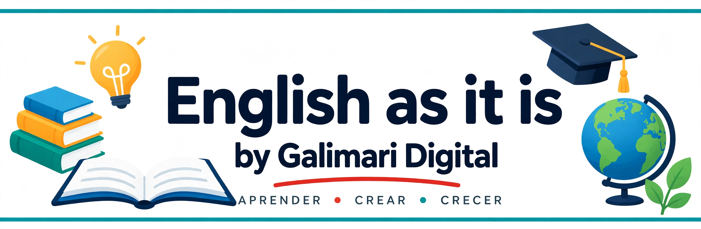

# English as it is

Free, self-paced ESL wordlist lessons. Learn by doing, like freeCodeCamp for English.

This project is named for my daughters, Galilea and Maria Jose — Galimari Digital. Aprender • Crear • Crecer.

## How it works

- Free, self-paced, and learn by doing. No long lectures.
- Each lesson is a wordlist, with fill-in-the-blanks practice and an interactive workbook.
- Short challenges, instant feedback, and repetition to make the words stick.
- Work through the lessons in order. No electives, no guesswork.

## Support this project

English as it is is free for every student, and it always will be. If it helped you learn, a donation of any kind helps keep it free and growing — but it is never required.

- Sponsor on GitHub: https://github.com/sponsors/GMD-English-As-It-Is

## Become a member

Everything free stays free, forever. Membership adds live teaching and extras on top — it never locks the lessons, audio, or workbooks.

- Supporter — 100 MXN/month (about $5 USD)
- Conversation Club — 200 MXN/month (about $10 USD), with a weekly live group conversation class
- 1-on-1 Learner — 500 MXN/month (about $25 USD), with a private lesson every month

Prices are in Mexican pesos for learners in Mexico. Outside Mexico, pay the equivalent in your currency.

See [MEMBERSHIP.md](MEMBERSHIP.md) for everything included, or join on Ko-fi: https://ko-fi.com/gmdenglishasitis

## Lessons

| Lesson | Topic | Wordlist |
| --- | --- | --- |
| 1 | Body | [lessons/01-body/wordlist.md](lessons/01-body/wordlist.md) |
| 2 | Clothes | [lessons/02-clothes/wordlist.md](lessons/02-clothes/wordlist.md) |
| 3 | Food | [lessons/03-food/wordlist.md](lessons/03-food/wordlist.md) |
| 4 | World | [lessons/04-world/wordlist.md](lessons/04-world/wordlist.md) |
| 5 | School | [lessons/05-school/wordlist.md](lessons/05-school/wordlist.md) |

## Lesson 1 — Body

36 body words, a/an, singular and plural, plural pronunciation [S] / [Z], and This is / These are.

- Wordlist: [lessons/01-body/wordlist.md](lessons/01-body/wordlist.md)
- Interactive workbook: https://muse.ai/s/body-lesson-1-workbook-an6xixrx08mxhe4/Re3xdfT2mcEsJ_xmYCXiUlQWa-5crgI6H1_HupHBftE
- Audio: [lessons/01-body/audio/](lessons/01-body/audio/) — 49 recorded clips, one per word and question. Tap the speaker in the workbook to hear them.

## Lesson 2 — Clothes

30 clothes words, describing words, colors, this/that/these/those, to-be questions, possessives, and Whose?

- Wordlist: [lessons/02-clothes/wordlist.md](lessons/02-clothes/wordlist.md)
- Interactive workbook: https://muse.ai/s/clothes-lesson-2-workbook-sf6xjgxlxpxfm2xw/EPp8vrZYefornaot9EgbtVP67L8I-ZMfnrXus0L-AQ0
- Audio: [lessons/02-clothes/audio/](lessons/02-clothes/audio/) — 64 recorded clips, one per word and question. Tap the speaker in the workbook to hear them.

## Lesson 3 — Food

Food words, a/an and some, on/off, present tense to be, and How much?

- Wordlist: [lessons/03-food/wordlist.md](lessons/03-food/wordlist.md)
- Audio: [lessons/03-food/audio/](lessons/03-food/audio/) — 55 recorded clips, one per word and question.

## Lesson 4 — World

The world, the, in/out of, only, to/from, between, past tense to be, much/many, where?, and What time is it?

- Wordlist: [lessons/04-world/wordlist.md](lessons/04-world/wordlist.md)
- Audio: [lessons/04-world/audio/](lessons/04-world/audio/) — 46 recorded clips, one per word and question.

## Lesson 5 — School

School words, about/with/without/for/at, prepositions, future tense to be, who/when/how/why/because, there is/are, how many/how much, and some/any.

- Wordlist: [lessons/05-school/wordlist.md](lessons/05-school/wordlist.md)
- Audio: [lessons/05-school/audio/](lessons/05-school/audio/) — 55 recorded clips, one per word and question.

## Structure

```
english-as-it-is/
  README.md
  MEMBERSHIP.md
  LICENSE.md
  CODE_OF_CONDUCT.md
  HISTORY.md
  lessons/
    01-body/
      wordlist.md
      audio/         # 49 recorded MP3 clips
    02-clothes/
      wordlist.md
      audio/         # 64 recorded MP3 clips
    03-food/
      wordlist.md
      audio/         # 55 recorded MP3 clips
    04-world/
      wordlist.md
      audio/         # 46 recorded MP3 clips
    05-school/
      wordlist.md
      audio/         # 55 recorded MP3 clips
```

Each lesson folder will later also hold its interactive workbook.

## How this project started

Manny started with one ESL class idea in November 2026, and built
it with Muse into a free, public learning site — 5 lessons from
Lane's Book 1, interactive workbooks, recorded audio, and a paid
members area on top that never locks the free lessons.

See [HISTORY.md](HISTORY.md) for the full log of how we built it
together.

## License and credit

Learning content in this project is licensed under CC BY 4.0, and
code is licensed under the MIT License. See [LICENSE.md](LICENSE.md)
for the full terms.

Source: Lane's English as a Second Language, Book 1, by Richard R.
Lane, Ph.D. — given freely to all students and teachers, and not to
be changed without written permission. Please credit Dr. Lane for
that source.

## Code of Conduct

This is a kind, respectful place to learn English, especially for
learners who are not native speakers. Mistakes are welcome here.
See [CODE_OF_CONDUCT.md](CODE_OF_CONDUCT.md).
